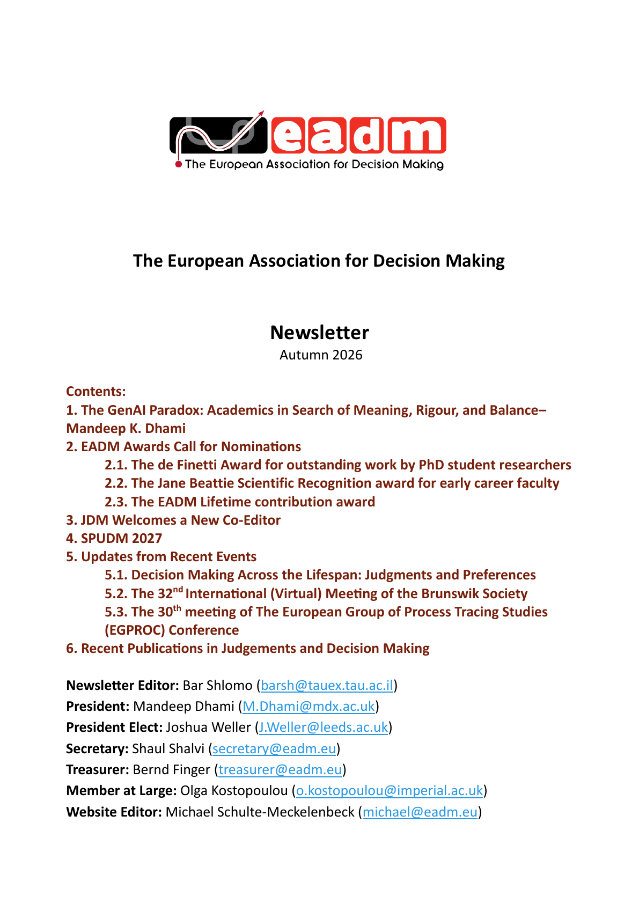

The November 2026 issue of the EADM Newsletter discusses generative AI
in academic work and announces the call for EADM award nominations. In
this issue:

1. The GenAI Paradox: Academics in Search of Meaning, Rigour, and Balance – Mandeep K. Dhami
2. EADM Awards Call for Nominations
    - The de Finetti Award for outstanding work by PhD student researchers
    - The Jane Beattie Scientific Recognition award for early career faculty
    - The EADM Lifetime contribution award
3. JDM Welcomes a New Co-Editor
4. SPUDM 2027 – Doron Sonsino
5. Updates from Recent Events
    - Decision Making across the Lifespan: Judgments and Preferences
    - The 32nd International (Virtual) Meeting of the Brunswik Society
    - The 30th meeting of The European Group of Process Tracing Studies – Lukasz, Tim and Cher
6. Recent Publications in Judgment and Decision Making

[{.eadm-newsletter-cover fig-alt="Cover page of the EADM Newsletter, November 2026"}](/files/2026/11/EADM-Newsletter-2026-11.pdf)

[Read the full newsletter (PDF)](/files/2026/11/EADM-Newsletter-2026-11.pdf) ·
[Newsletter archive](/newsletter/index.qmd)
