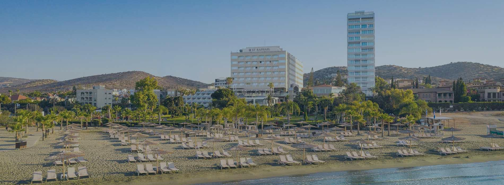
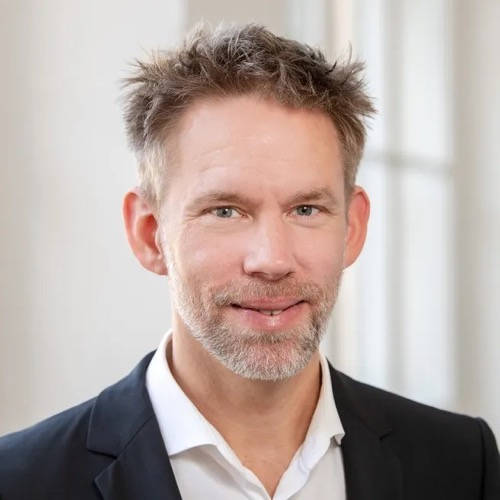

[{fig-alt="SPUDM 2027 – Subjective Probability, Utility & Decision Making"}](https://cyprusconferences.org/spudm2027/)

The 31st Subjective Probability, Utility and Decision Making (SPUDM)
Conference will be held at the
[St. Raphael beach resort](https://cyprusconferences.org/spudm2027/venue/)
in Limassol, Cyprus. The conference will open on the afternoon of
**Wednesday, September 1, 2027**, and conclude on **Sunday, September 5,
2027**.

{fig-alt="The St. Raphael beach resort and its beach in Limassol, Cyprus"}

The program will feature regular and flash talks, keynote lectures,
symposia, poster exhibitions, and social activities including a
Tavern-style dinner event.

## Keynote speakers

:::::: {.eadm-keynotes}

::: {.eadm-keynote}
{fig-alt="Portrait of Thorsten Pachur"}

[Thorsten Pachur](https://www.msl.mgt.tum.de/en/brm/team/thorsten-pachur/)
:::

::: {.eadm-keynote}
{fig-alt="Portrait of Elke Weber"}

[Elke Weber](https://elke-u-weber.com/)
:::

::: {.eadm-keynote}
{fig-alt="Portrait of Nils Köbis"}

[Nils Köbis](https://rc-trust.ai/about/scientists/nils-koebis)
:::

::::::

## Submissions

The submission portal is now open and will close on **February 14, 2027
(PST)**.

SPUDM is the biennial conference of the
[European Association for Decision Making](/spudm/index.qmd) and welcomes
submissions from all fields of judgment and decision making, including
Psychology, Economics, Management, Health, Law, and related disciplines.

The 2027 meeting is organized by the
[University of Limassol (UoL)](https://www.uol.ac.cy/en/), and we look
forward to welcoming researchers from across the world to Limassol.

More information on the conference is available at
<https://cyprusconferences.org/spudm2027/>.

Best wishes,

[Doron Sonsino](https://www.doronsonsino.net/)\
Chair of the Conference Committee
